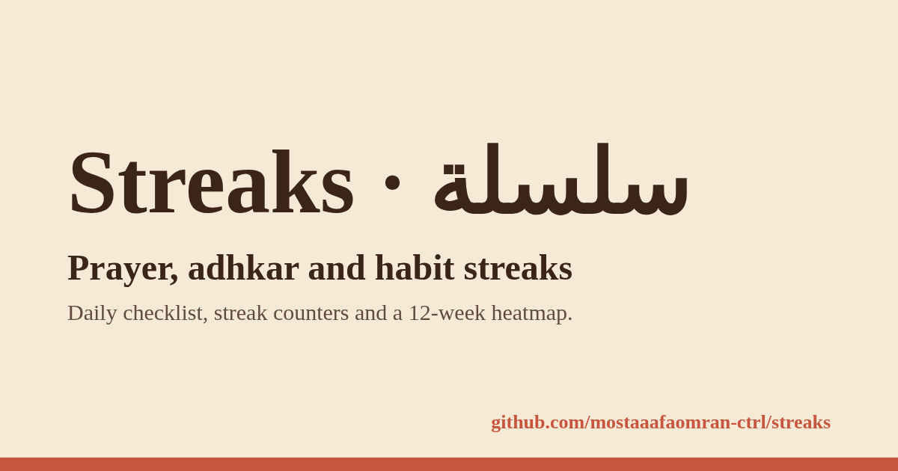

# Streaks · سلسلة

Prayer, adhkar and habit streak tracker (PWA).

**Live:** https://mostaaafaomran-ctrl.github.io/streaks/

## What it does

- Five prayers, morning and evening adhkar, Quran, plus your own habits
- Current and best streak for every habit
- 12-week heatmap and perfect-day count
- Saved on your device only, export and import as JSON, installable as an app

## Use it

Open the live link. No signup, no server. To run it locally, clone the repo and open `index.html` in a browser.

## بالعربي

متابعة الصلوات والأذكار وعاداتك اليومية مع سلاسل الالتزام وخريطة حرارية لآخر ١٢ أسبوع.

## License

MIT
